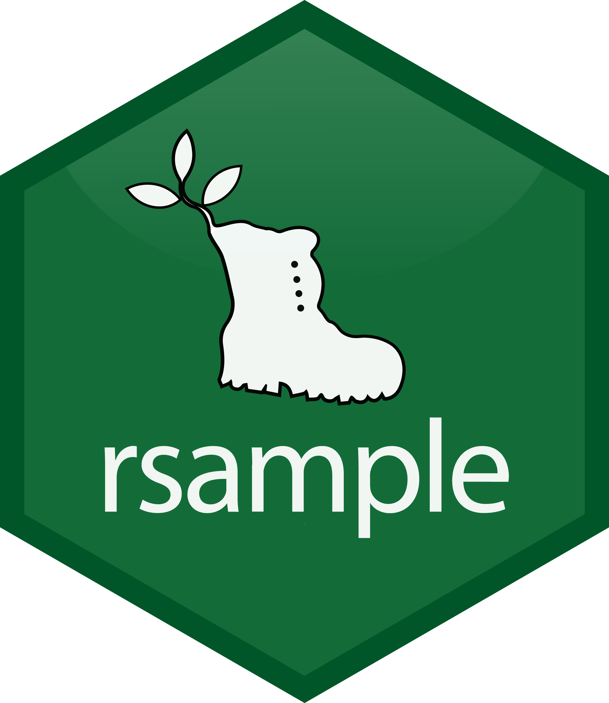
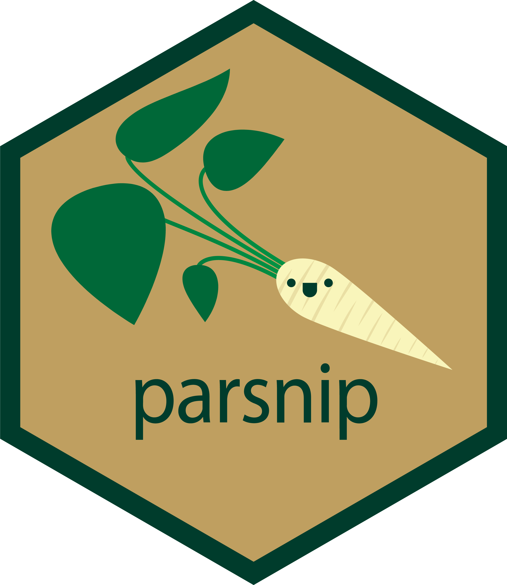
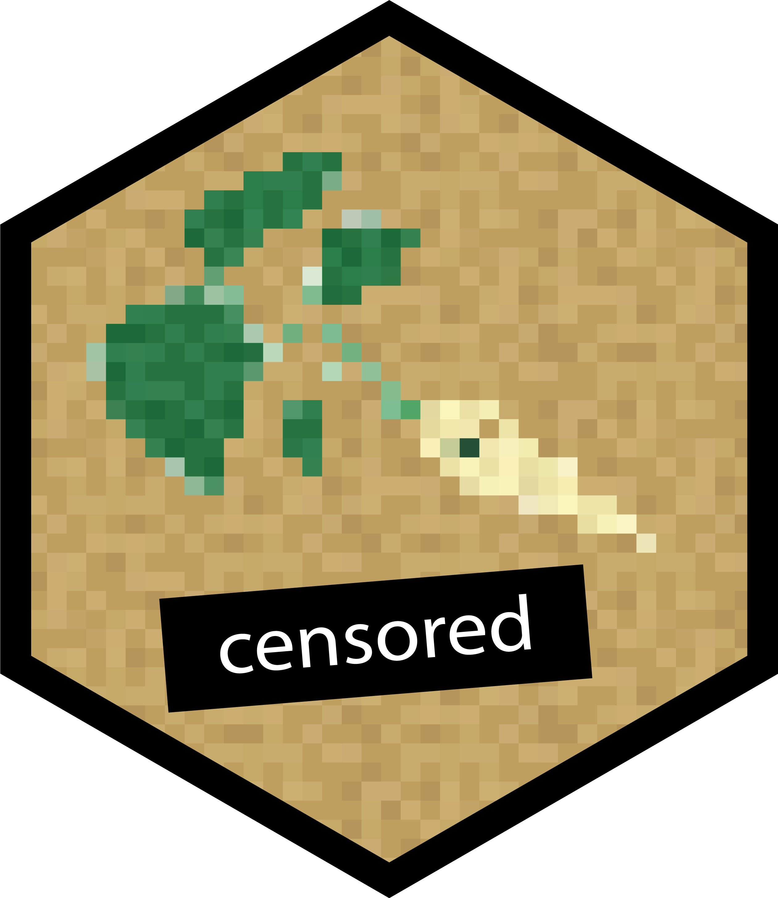
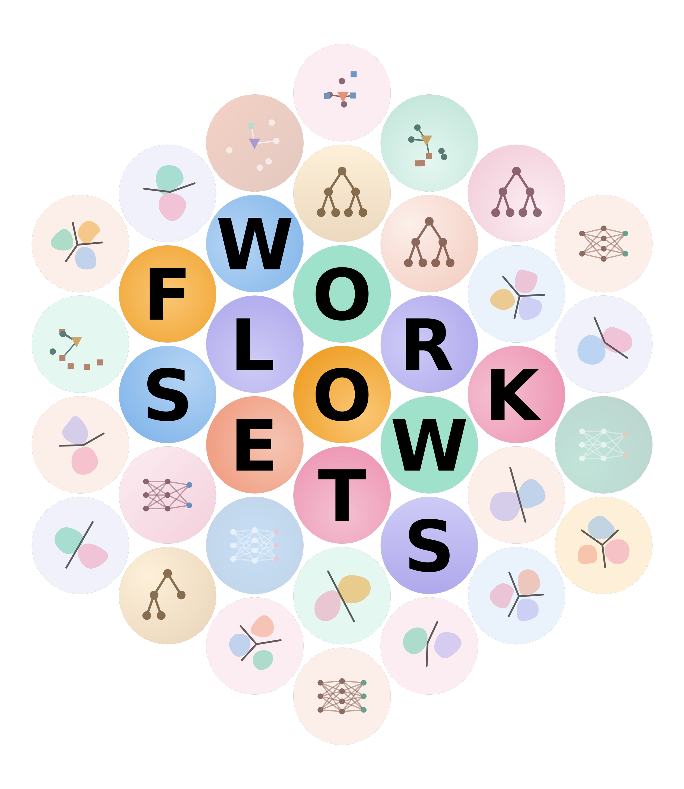
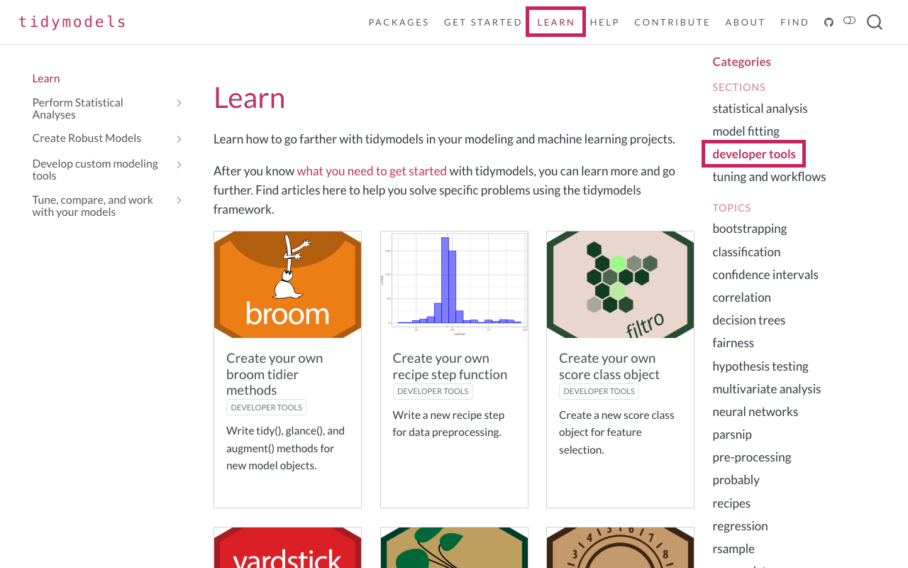
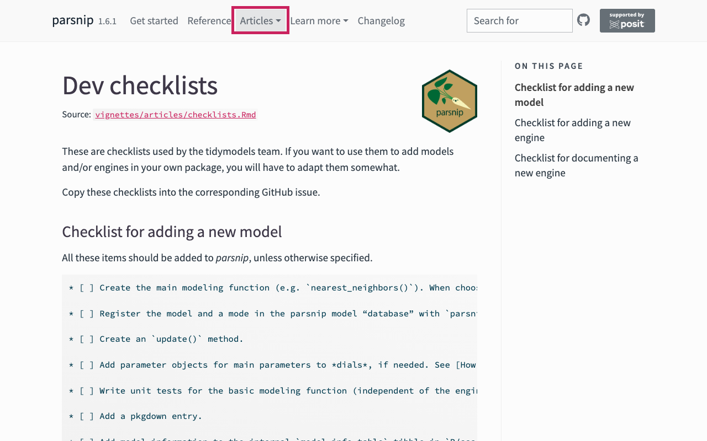
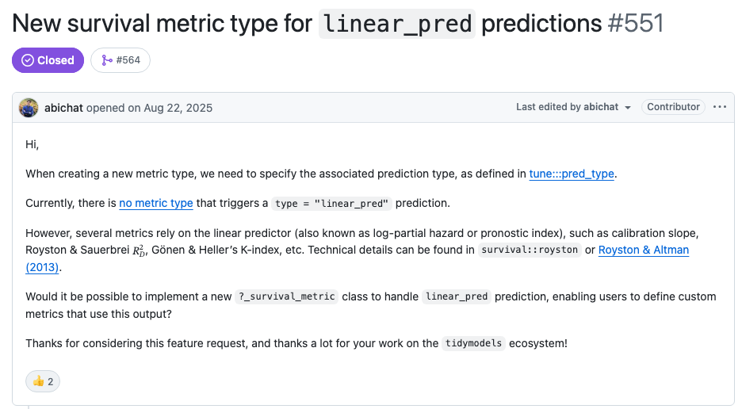

```{r setup}
#| include: false
library(tidymodels)
library(censored)
library(tidyverse)
library(ggsurvfit)
tidymodels_prefer()

options(width = 70, pillar.print_min = 10, pillar.print_max = 10)
theme_set(theme_minimal(base_size = 20))

source(here::here("R/prep-projects.R"))
```

## Budget participatif

<!-- Hook / data ----------------------------------------------------------- -->

:::: {.columns}
::: {.column width="55%"}
- Every year since 2014, Parisians propose and vote on projects
- Greening a schoolyard, a new playground, a sports facility, ...
- **How long from the vote until the project opens?**
:::
::: {.column width="45%"}
{height="540" fig-align="center" fig-alt="Colourful numbered stepping stones of a hopscotch game in a playground"}

::: {style="text-align: center; font-size: 0.5em"}
Photo by [Eric Tompkins](https://unsplash.com/@erictompkins) on [Unsplash](https://unsplash.com/photos/multicolored-number-boards-tRIw6cFSs2E)
:::
:::
::::

::: {.notes}
- city tracks every project from studies through to opening
:::

## The data

```{r}
#| label: glimpse
glimpse(projects)
```

[Source: Ville de Paris, opendata.paris.fr, licence ODbL]{style="font-size: 0.6em"}

::: {.notes}
- one row per project, editions 2014–2025 (no 2020 edition)
- a project counts as open once all of its operations (sites) are open
- months: from the vote until opening, or until today if it's not open yet
:::

<!-- Censoring ------------------------------------------------------------- -->

```{r}
#| label: swimmer-setup
#| include: false
set.seed(11)
swimmers <- projects_dates |>
  filter(edition >= 2017) |>
  slice_sample(n = 6, by = opened) |>
  arrange(vote_date, end_date) |>
  mutate(id = factor(row_number()))

swimmer_plot <- function(data) {
  ggplot(data, aes(y = id)) +
    geom_vline(xintercept = snapshot_date, linetype = "dashed") +
    geom_segment(
      aes(x = vote_date, xend = end_date, yend = id, alpha = keep),
      linewidth = 1.2
    ) +
    geom_point(
      aes(x = end_date, shape = status, alpha = keep),
      size = 5,
      fill = "white",
      stroke = 1.5
    ) +
    scale_shape_manual(values = c(opened = 16, "not open yet" = 21)) +
    scale_alpha_manual(values = c("TRUE" = 1, "FALSE" = 0.15), guide = "none") +
    labs(x = "Calendar time", y = NULL, shape = NULL) +
    theme(
      axis.text.y = element_blank(),
      panel.grid.major.y = element_blank(),
      legend.position = "top"
    )
}
```

## Time to event

```{r}
#| label: swimmer
#| fig-alt: "Timeline of 12 example projects, each drawn as a horizontal line from its vote, between 2017 and 2025, to its end. Six projects end in a filled dot where they opened. The other six run up to a dashed line marking today and end in an open circle: they are not open yet."
#| echo: false
#| fig-width: 11
#| fig-height: 5.5
swimmers |>
  mutate(
    status = if_else(opened, "opened", "not open yet"),
    keep = TRUE
  ) |>
  swimmer_plot()
```

::: {.notes}
- we know it's taken *at least* this long, not how long it will take
:::

## Everything is an event?

```{r}
#| label: swimmer-all-events
#| fig-alt: "Timeline of 12 example projects, each drawn as a horizontal line from its vote, between 2017 and 2025, to its end. All twelve end in a filled dot as if they had opened, including the six that are still waiting and whose lines stop at the dashed line marking today."
#| echo: false
#| fig-width: 11
#| fig-height: 5.5
swimmers |>
  mutate(status = "opened", keep = TRUE) |>
  swimmer_plot()
```

Use the observed time as if every project had opened<br>→ underestimates the time until opening

::: {.notes}
- plain regression on the observed time
- the projects still waiting are treated as if they opened today
:::

## Drop the ones still waiting?

```{r}
#| label: swimmer-drop
#| fig-alt: "Timeline of 12 example projects, each drawn as a horizontal line from its vote, between 2017 and 2025, to its end. The six projects that have opened are shown in full. The six still waiting, which have the longest lines, are faded out."
#| echo: false
#| fig-width: 11
#| fig-height: 5.5
swimmers |>
  mutate(
    status = if_else(opened, "opened", "not open yet"),
    keep = opened
  ) |>
  swimmer_plot()
```

Only use projects that have opened<br>→ throws away data, and biased: the slow ones are the ones still waiting

::: {.notes}
- not missing at random
- here: almost 40% are not open yet!
- especially recent editions would be left with only their fastest projects
:::

## Survival analysis

- The right tool for _censored regression_
- Despite the name, the event can be loads of things:
  - A project opening
  - A business closing
  - Leaving unemployment or benefits
  - A household responding during fieldwork

::: {.notes}
:::

<!-- OPTIONAL slide: Kaplan-Meier curve -->

## Kaplan-Meier curve

```{r}
#| label: km
#| echo: false
#| fig-width: 11
#| fig-height: 5.5
survfit2(Surv(months, opened) ~ 1, data = projects) |>
  ggsurvfit(linewidth = 1) +
  add_censor_mark(size = 2, alpha = 0.5) +
  scale_y_continuous(labels = scales::percent, limits = c(0, 1)) +
  #labs(x = "Months since the vote", y = "Share of projects not yet open") +
  theme_minimal(base_size = 20)
```

::: {.notes}
- Time = Months since the vote
- Survival prob = prob the project is not yet open
- ticks: censored projects, they count as "still waiting" up until they leave the data
:::

<!-- tidymodels ------------------------------------------------------------ -->

## tidymodels

{.absolute top="200" left="0" width="150" fig-alt="rsample hex logo"}
{.absolute top="200" left="250" width="150" fig-alt="recipes hex logo"}
{.absolute top="200" left="400" width="150" fig-alt="workflows hex logo"}
{.absolute top="200" left="550" width="150" fig-alt="parsnip hex logo"}
{.absolute top="200" left="800" width="150" fig-alt="yardstick hex logo"}
{.absolute top="200" left="1050" width="150" fig-alt="tune hex logo"}
{.absolute top="400" left="825" width="250" fig-alt="tidymodels hex logo"}

::: {.notes}
- a framework for statistical modelling and machine learning
- we take care of the procedural code / boilerplate, so you can focus on the modelling question
- consistent interfaces make it easy to explore options: models, preprocessing, metrics, tuning
- guardrails against pitfalls such as data leakage make it safe
- (click) censored: survival analysis across the whole framework
:::

. . .

{.absolute top="333" left="626" width="150" fig-alt="censored hex logo"}


## Setting up

```{r}
#| label: setup-code
#| code-line-numbers: "1-2|4-7|9-12|14-16"
projects <- projects |>
  mutate(opening_time = Surv(months, opened), .keep = "unused")

set.seed(403)
projects_split <- initial_split(projects, prop = 0.8)
projects_train <- training(projects_split)
projects_folds <- vfold_cv(projects_train, v = 10)

projects_rec <- recipe(opening_time ~ ., data = projects_train) |>
  update_role(project, new_role = "id") |>
  step_log(budget, n_operations) |>
  step_other(arrondissement, theme, threshold = 0.02)

cox_spec <- proportional_hazards() |>
  set_engine("survival") |>
  set_mode("censored regression")
```

::: {.notes}
:::

<!-- What's new: models ---------------------------------------------------- -->

# What's new: models

## Two new engines for random forests

```{r}
#| label: spec-rf
#| code-line-numbers: "1,5|2,6|1-7"
ranger_spec <- rand_forest(trees = 500) |>
  set_engine("ranger") |>
  set_mode("censored regression")

rfsrc_spec <- rand_forest(trees = 500) |>
  set_engine("randomForestSRC") |>
  set_mode("censored regression")
```

::: {.notes}
- switching model type or engine is one line
- why these? they are fast
- why random forests? generally work well out of the box
- but also: why tree-based models? censored has quite a few of those!
- censored smooths over engine quirks, e.g. randomForestSRC's 0/1 status coding and pre-made Surv responses in recipes
:::

## Survival trees

```{r}
#| label: tree-illustration
#| fig-alt: "Survival tree with two splits, each leaf showing a survival curve. Projects from editions 2020 and later form one leaf of 366 projects, whose curve stays above 70% over the five years observed. Earlier editions are split by budget at 64,500 €: for the 189 smaller projects, half are open after about 20 months; for the 545 larger projects, after about 40 months."
#| echo: false
#| fig-width: 12
#| fig-height: 6
decision_tree(tree_depth = 2) |>
  set_engine("rpart") |>
  set_mode("censored regression") |>
  fit(opening_time ~ budget + theme + edition, data = projects_train) |>
  extract_fit_engine() |>
  pluck("rpart") |>
  partykit::as.party() |>
  plot()
```

::: {.notes}
- a forest averages many such trees
- each leaf holds a survival curve, not a single number
- flexible: no proportional hazards assumption
- data-driven groupings
:::

## A null model as your true baseline

```{r}
#| label: spec-null
null_spec <- null_model() |>
  set_engine("survival") |>
  set_mode("censored regression")
```

- Ignores all predictors: one Kaplan-Meier curve for everyone
- Does your model beat doing nothing?

## The same prediction for everyone {visibility="hidden"}

```{r}
#| label: null-fit
null_wflow <- workflow(projects_rec, null_spec)
null_fit <- fit(null_wflow, data = projects_train)

predict(null_fit, slice(testing(projects_split), 1:3), type = "time")
```

::: {.notes}
- three different projects, same predicted time: the median of the Kaplan-Meier curve
:::

## Predicting survival probabilities {visibility="hidden"}

```{r}
#| label: null-pred-survival
null_pred <- predict(
  null_fit,
  slice(testing(projects_split), 1:3),
  type = "survival",
  eval_time = c(12, 24, 36, 48)
)
null_pred$.pred[[1]]
```

::: {.notes}
- probability of not being open yet, at chosen points in time (here every year)
- one tibble per project, nested in .pred: still one row per project
- the same for every project with the null model
- this is the type of prediction the Brier score works with
:::

## Resampling the null model

```{r}
#| label: null-resamples
#| cache: true
null_wflow <- workflow(projects_rec, null_spec)

projects_metrics <- metric_set(
  brier_survival,
  brier_survival_integrated,
  concordance_survival
)

null_res <- fit_resamples(
  null_wflow,
  resamples = projects_folds,
  metrics = projects_metrics,
  eval_time = 1:96
)
```

::: {.notes}
- we take care of the procedural code: 10 fits, predictions on the held-out folds, metrics at 96 time points, collected for you
- Brier score: how close the predicted probability is to what happened, at time t (lower is better)
- every month for the first 8 years; longer than that, only the earliest editions are followed up and estimates get noisy
:::

## The baseline

```{r}
#| label: null-brier
#| echo: false
#| fig-width: 11
#| fig-height: 5.5
null_brier <- collect_metrics(null_res) |>
  filter(.metric == "brier_survival")

ggplot(null_brier, aes(.eval_time, mean)) +
  geom_line(linewidth = 1.5, linetype = "dashed") +
  labs(x = "Months since the vote", y = "Brier score (lower is better)")
```

::: {.notes}
- the Brier score of the null model over time
- low at first: almost no project opens in the first months, easy to predict
- peaks when it's hardest to tell who's still waiting
:::

<!-- tidymodels for survival analysis -------------------------------------- -->

## Many models at once

```{r}
#| label: workflow-set
#| cache: true
projects_res <- workflow_set(
  preproc = list(rec = projects_rec),
  models = list(
    null = null_spec,
    cox = cox_spec,
    ranger = ranger_spec,
    rfsrc = rfsrc_spec
  )
) |>
  workflow_map(
    "fit_resamples",
    resamples = projects_folds,
    metrics = projects_metrics,
    eval_time = 1:96,
    seed = 1
  )
```

::: {.notes}
- we take care of the procedural code, again: 4 models × 10 folds
- you focus on the modelling choices: preprocessing, models, metrics

- link to production: a short declarative specification instead of hand-written loops
- easier to review, easy to rerun when next year's data arrives
- auditable, reproducible, same code gives same results
:::

## Every model beats the baseline

```{r}
#| label: brier-over-time
#| echo: false
#| fig-width: 11
#| fig-height: 5.5
brier <- collect_metrics(projects_res) |>
  filter(.metric == "brier_survival") |>
  mutate(model = str_remove(wflow_id, "rec_"))

ggplot(brier, aes(.eval_time, mean, group = model)) +
  geom_line(
    data = filter(brier, model != "null"),
    aes(color = model),
    linewidth = 0.8
  ) +
  geom_line(
    data = filter(brier, model == "null"),
    linewidth = 1.5,
    linetype = "dashed"
  ) +
  annotate(
    "text",
    x = 45,
    y = max(filter(brier, model == "null")$mean),
    label = "null model",
    vjust = -0.8,
    size = 6
  ) +
  expand_limits(y = max(brier$mean) * 1.1) +
  labs(
    x = "Months since the vote",
    y = "Brier score (lower is better)",
    color = NULL
  )
```

::: {.notes}
- ranger: The cause is ranger's default minimum node size of 3 for survival forests. Tiny terminal nodes keep survival curves flat at high values in the tail.
:::

<!-- OPTIONAL: getting to the final model ---------------------------------- -->

## The final model {visibility="hidden"}

```{r}
#| label: final-fit
#| cache: true
best_id <- rank_results(
  projects_res,
  rank_metric = "brier_survival_integrated"
) |>
  slice_head(n = 1) |>
  pull(wflow_id)

final_fit <- projects_res |>
  extract_workflow(best_id) |>
  last_fit(projects_split, metrics = projects_metrics, eval_time = 1:96)
```

::: {.notes}
- OPTIONAL slide
- rank by integrated Brier score, take the best workflow
- last_fit(): fit on all of the training data, evaluate once on the test data
:::

## Predictions are survival curves {visibility="hidden"}

```{r}
#| label: example-curves
#| fig-alt: "Predicted survival curves, the probability of not yet being open over 96 months since the vote, for four projects from the 2018 edition. The living environment project with a budget of 590K € is slowest, with about a 40% chance of still not being open after 8 years. The sport (200K €) and culture (650K €) projects end around 15 to 20%, and the education project (250K €) is fastest, ending below 10%."
#| echo: false
#| fig-width: 11
#| fig-height: 5.5
set.seed(4)
examples <- testing(projects_split) |>
  filter(
    edition == 2018,
    theme %in% c("sport", "education", "culture", "living environment")
  ) |>
  slice_sample(n = 1, by = theme)

final_fit |>
  extract_workflow() |>
  augment(examples, eval_time = 1:96) |>
  mutate(
    label = paste0(
      theme,
      ", ",
      scales::label_currency(
        prefix = "",
        suffix = " €",
        scale_cut = scales::cut_short_scale()
      )(budget)
    )
  ) |>
  select(label, .pred) |>
  unnest(.pred) |>
  ggplot(aes(.eval_time, .pred_survival, color = label)) +
  geom_line(linewidth = 1) +
  scale_y_continuous(labels = scales::percent) +
  labs(
    x = "Months since the vote",
    y = "Probability not yet open",
    color = NULL,
    subtitle = "Four projects from the 2018 edition"
  )
```

::: {.notes}
- OPTIONAL slide
- one curve per project, from the best model
- all from the same edition, so the differences come from theme and budget
:::

<!-- Built to be extended -------------------------------------------------- -->

# Built to be extended

## We extend

{.absolute top="200" left="0" width="150" fig-alt="rsample hex logo"}
{.absolute top="200" left="250" width="150" fig-alt="recipes hex logo"}
{.absolute top="200" left="400" width="150" fig-alt="workflows hex logo"}
{.absolute top="200" left="550" width="150" fig-alt="parsnip hex logo"}
{.absolute top="200" left="800" width="150" fig-alt="yardstick hex logo"}
{.absolute top="200" left="1050" width="150" fig-alt="tune hex logo"}

. . .

{.absolute top="333" left="76" width="150" fig-alt="spatialsample hex logo"}
{.absolute top="333" left="326" width="150" fig-alt="textrecipes hex logo"}
{.absolute top="466" left="250" width="150" fig-alt="embed hex logo"}
{.absolute top="333" left="476" width="150" fig-alt="workflowsets hex logo"}
{.absolute top="333" left="626" width="150" fig-alt="censored hex logo"}
{.absolute top="333" left="1126" width="150" fig-alt="finetune hex logo"}

::: {.notes}
- tidymodels is built to be extended
- we have extended the core packages ourselves: spatialsample, recipes extensions, parsnip extensions, workflowsets, finetune
- not much for yardstick so far
:::

## You extend: developer articles

[{height="500" fig-align="center"}](https://www.tidymodels.org/learn/#category=developer%20tools)

[<https://www.tidymodels.org/learn/#category=developer%20tools>]{style="font-size: 0.6em"}

::: {.notes}
- you can build your own: models, engines, recipe steps, metrics, tidiers
- we've written down how: tidymodels.org, Learn, developer tools
:::

## You extend: checklists

[{height="500" fig-align="center" fig-alt="The Dev checklists article in the Articles menu of the parsnip website, with checklists for adding a new model, adding a new engine, and documenting a new engine."}](https://parsnip.tidymodels.org/articles/checklists.html)

[<https://parsnip.tidymodels.org/articles/checklists.html>]{style="font-size: 0.6em"}

::: {.notes}
- the checklists we use ourselves, for new models and engines
- in the Articles menu of the parsnip website
- recipes has one for new steps: <https://recipes.tidymodels.org/articles/checklists.html>
:::

## You extend: skills

[{height="500" fig-align="center" fig-alt="Homepage of tidymodels skills: Claude Code Skills for Tidymodels, to build models or create extensions following best practices."}](https://skills.tidymodels.org)

[<https://skills.tidymodels.org>]{style="font-size: 0.6em"}

::: {.notes}
- Claude Code skills for tidymodels: for using it, and for creating extensions following our practices
:::

## Something missing? Ask us!

[{width="820" fig-align="center" fig-alt="Closed GitHub issue 551 in yardstick, titled New survival metric type for linear_pred predictions. The user asks for a metric type that triggers linear predictor predictions, so they can write metrics such as Royston and Sauerbrei's R²_D."}](https://github.com/tidymodels/yardstick/issues/551)

. . .

→ yardstick: a new metric type for the linear predictor, and `royston_survival()`

::: {.notes}
- a user wanted to write their own metrics on the linear predictor
- that wasn't possible: no metric type triggered that kind of prediction
- they asked, we built it
- they also wanted Royston and Sauerbrei's metric, so we added that as well
- the same user also asked for easier access to censoring weights in predict() (parsnip #1371)
:::

## Royston's metric {visibility="hidden"}

```{r}
#| label: royston-cox
#| cache: true
workflow(projects_rec, cox_spec) |>
  fit_resamples(
    projects_folds,
    metrics = metric_set(royston_survival, concordance_survival)
  ) |>
  collect_metrics()
```

::: {.notes}
- how well the linear predictor separates the projects
- mixes with existing metric types in the same metric set
- needs a linear predictor: Cox, Weibull, boosted tree, but not the forests or the null model
- royston_survival() reports R²_D, the explained-variation version of D
:::

<!-- Recap and closing ----------------------------------------------------- -->

## What's new

- Random forests via `"ranger"` and `"randomForestSRC"`
- A null model as a baseline
- A new metric type for the linear predictor, and Royston-Sauerbrei's metric
- Also new: faster tuning for boosted trees, censoring weights in `predict()`

<br>

<!-- TODO: add link to the censored 0.4.0 blog post once it's published -->

::: {.notes}
- boosted trees with mboost: multi_predict(), so tune_grid() fits one model per number of trees
:::

## Durations with unfinished cases?

- Censored regression in tidymodels works just like classification or regression
- If something is missing, you can extend the framework, or ask us

<br>

::: {style="text-align: center"}
<https://www.tidymodels.org>
:::


<!-- Backup slides --------------------------------------------------------- -->

# Backup {visibility="uncounted"}

## Case weights {visibility="uncounted"}

```{r}
#| label: case-weights
#| echo: false
c(
  "proportional_hazards",
  "survival_reg",
  "decision_tree",
  "bag_tree",
  "boost_tree",
  "rand_forest"
) |>
  map(\(model) {
    engines <- get_model_env()[[paste0(model, "_fit")]] |>
      filter(mode == "censored regression") |>
      pull(engine)
    allowed <- map_lgl(engines, \(engine) {
      get(model, asNamespace("parsnip"))() |>
        set_engine(engine) |>
        set_mode("censored regression") |>
        parsnip:::case_weights_allowed()
    })
    tibble(
      model = paste0(model, "()"),
      `with case weights` = paste(engines[allowed], collapse = ", "),
      `without` = paste(engines[!allowed], collapse = ", ")
    )
  }) |>
  list_rbind() |>
  knitr::kable()
```

::: {.notes}
- censored 0.4.0: bag_tree() with rpart and boost_tree() with mboost no longer accept case weights
- ipred errors with weights; mboost fits with weights but can't predict from those fits
:::

## Coming from SAS {visibility="uncounted"}

| SAS | R/tidymodels |
|---|---|
| `PROC LIFETEST` | `survival::survfit()`, `null_model()` |
| `PROC PHREG` | `proportional_hazards()` |
| `PROC LIFEREG` | `survival_reg()` |

::: {.notes}
- same models, different defaults: PHREG uses Breslow for ties (R: Efron), LIFETEST uses log-log CIs (R: log)
:::

## Data caveats {visibility="uncounted"}

- Opening dates are given to the month
- The vote is approximated as 1 October of the edition year
- Source: Ville de Paris, *Budget participatif : opérations des projets gagnants et réalisations*, opendata.paris.fr, licence ODbL

## Abandoned projects {visibility="uncounted"}

- About 5% of operations are abandoned: they will never open
- That's a competing risk; here we dropped them
